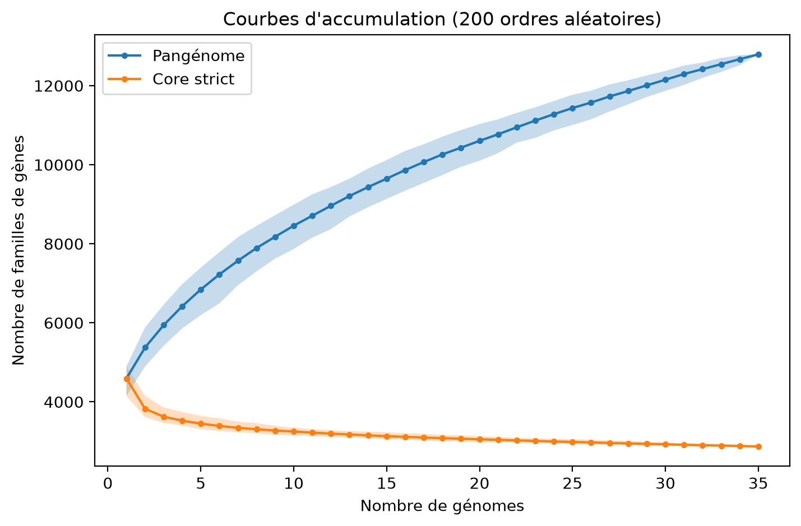
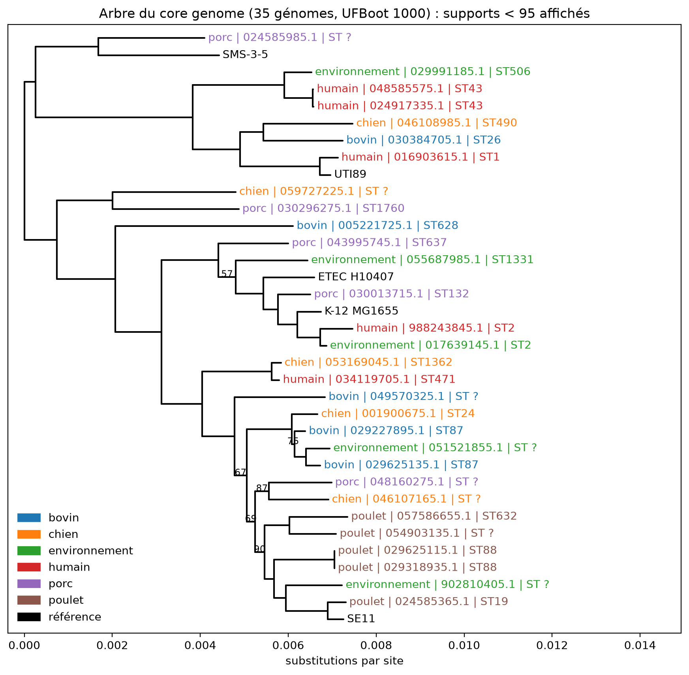

# Comparative genomics of *Escherichia coli*: genome size, pangenome and core-genome phylogeny

A personal learning project in comparative genomics. I started with 5 well-known *E. coli* reference genomes, then extended the analysis to 35 complete genomes (the 5 references + a 30-genome panel balanced by origin: human, pig, chicken, cattle, dog, environment). The goal was to learn how bacterial genomes are compared (size, gene content, core/accessory genome, phylogeny) and to build a reproducible pipeline with Python, Biopython and standard command-line tools.

> **Status:** analysis complete (including branch supports for the 35-genome tree). See [Limitations](#limitations) and [To do](#to-do).

## Main findings

| Question | Result |
|---|---|
| How much do genome sizes differ? | 4.64 Mb (K-12 MG1655) to 5.33 Mb (ETEC H10407); GC content almost identical (50.5-50.8 %). K-12 has the smallest genome and the fewest proteins (4,300 vs 4,683-4,821 in the 4 other references). |
| Are the genomes the same species? | Yes: pairwise ANI between the 5 references is 96.5-99.3 % (FastANI). |
| How big is the pangenome? | 12,793 gene families in 35 genomes. Core (35/35): 2,871; soft core (34/35): 349; shell: 2,165; cloud (1-5 genomes): 7,408. |
| Is the pangenome open? | The curve does not plateau: the 35th genome still adds 122 new families (the 2nd added 781). Heaps' law exponent α = 0.63 (< 1, open pangenome; approximate with 35 genomes). |
| Does origin (host/environment) follow phylogeny or accessory gene content? | No detectable association once near-identical genomes are removed (13-18 % of nearest neighbours share an origin vs ~14 % expected by chance; see below). |

## Data

All data are public (NCBI RefSeq, complete genomes, downloaded with NCBI Datasets CLI v18.38.0). Genomes are not stored in this repository.

**5 reference genomes**

| Accession | Strain | Size (bp) | GC (%) | Replicons | Proteins |
|---|---|---|---|---|---|
| GCF_000005845.2 | K-12 MG1655 | 4,641,652 | 50.79 | 1 | 4,300 |
| GCF_000010385.1 | SE11 | 5,155,626 | 50.74 | 7 | 4,799 |
| GCF_000013265.1 | UTI89 | 5,179,971 | 50.61 | 2 | 4,752 |
| GCF_000019645.1 | SMS-3-5 | 5,215,377 | 50.49 | 5 | 4,683 |
| GCF_000210475.1 | ETEC H10407 | 5,325,888 | 50.69 | 5 | 4,821 |

**30-genome panel**: drawn at random (fixed seed, `random_state=42`) from the complete RefSeq *E. coli* genomes that have a host or isolation-source annotation, 5 genomes per origin category (human, pig, chicken, cattle, dog, environment). Accessions are listed in `data/panel30_accessions.txt`.

## Methods

1. **Genome statistics** (`stats_genomes.py`): total length, GC %, number of replicons, chromosome vs plasmid length with Biopython (`SeqIO.parse`, streaming).
2. **Whole-genome similarity**: FastANI 1.34, all-vs-all.
3. **Protein families**: all proteins from the 35 genomes were pooled (each header prefixed with the genome accession, because RefSeq gives identical `WP_` identifiers to identical proteins in different genomes) and clustered with MMseqs2 `easy-cluster` at 80 % identity and 80 % bidirectional coverage (`--min-seq-id 0.8 -c 0.8 --cov-mode 0`). Presence/absence and copy-number matrix built in streaming with `itertools.groupby` (`pangenome_n.py`).
4. **Pangenome categories** (35 genomes): core ≥ 99 % of genomes (35/35), soft core ≥ 95 % (34/35), shell 15-95 % (6-33), cloud < 15 % (1-5).
5. **Accumulation curves** (`accumulation.py`): genomes added one by one in 200 random orders, pangenome = cumulative union, core = cumulative intersection; Heaps' law fitted on the number of new families per added genome.
6. **Core-genome phylogeny**:
   - 3,160 single-copy families present in at least 34 of 35 genomes;
   - each family aligned with MAFFT 7.526 (`--auto`), 4 alignments in parallel (`core_alignement_n.py`); genomes missing from a family are padded with gaps; selenocysteine (U) replaced by X because MAFFT rejects it;
   - concatenation into a 987,816-column protein supermatrix (0.46 % gaps);
   - maximum-likelihood tree with IQ-TREE 3.1.4, model LG+G4. IQ-TREE collapses identical alignment columns: 987,816 columns reduce to 20,411 distinct patterns (96.6 % of sites are constant), which kept memory at ~441 MB. FastTree on the same matrix exceeded the 2.8 GB of RAM available to my WSL environment and crashed.
   - the tree is rooted at the midpoint for display only (no outgroup);
   - branch supports: ultrafast bootstrap (UFBoot, 1,000 replicates, `-B 1000`, starting from the ML tree; 33 minutes, 519 MB; correlation coefficient of split frequencies 1.000). After midpoint rooting, each support is re-attached to its bipartition (set of genomes on each side of the branch) so values are not shifted. A UFBoot support ≥ 95 is considered good (UFBoot convention; these values are not directly comparable to standard bootstrap percentages).
7. **Origin vs phylogeny test** (`test_origine_derepl.py`, `test_origine_accessoire.py`): for each of the 30 panel genomes, is its nearest neighbour (patristic distance on the core tree, or Jaccard distance on accessory gene content) of the same origin? The observed proportion is compared with random permutations of the origin labels (2,000 for the unfiltered test, 500 for each of the 200 draws of the filtered tests). Near-identical genomes were grouped (single linkage, thresholds 0.0001 and 0.001 substitutions/site) and one representative per group was drawn at random, 200 times, so clones are not counted as independent observations.

## Results

### Genome size and gene content (5 references)

K-12 MG1655 is 0.5-0.7 Mb smaller than the four other references, and has 400-500 fewer proteins. The extra genes of the other strains are not extra non-coding DNA. K-12 has a single replicon (no plasmid); the four other references carry 1 to 6 plasmids (114-268 kb in total per strain).

### ANI

| | K-12 | SE11 | UTI89 | SMS-3-5 | H10407 |
|---|---|---|---|---|---|
| K-12 | | 98.46 | 96.69 | 97.08 | 99.28 |
| SE11 | | | 96.47 | 96.96 | 98.19 |
| UTI89 | | | | 97.12 | 96.48 |
| SMS-3-5 | | | | | 96.91 |

ANI only measures the shared part of the genomes: K-12 and H10407 are 99.28 % identical on shared regions although their genomes differ by about 0.7 Mb.

### Pangenome

With the 5 references alone: 6,879 families (core 3,397; accessory 1,261; strain-specific 2,221). Averaged over random subsets of 5 genomes from the 35, the pangenome is 6,843 families and the strict core 3,448, so the 5 references were representative of the diversity of the panel. With 35 genomes: 12,793 families (see table above). 58 % of families are in the cloud, an upper bound since annotation differences and the 80 % identity threshold split some genes.



### Phylogeny



The tree separates two main groups, {UTI89, SMS-3-5, and relatives} and {K-12, ETEC H10407, SE11, and relatives}. Several genomes are essentially clonal (distance 0.00000-0.00004 substitutions/site, e.g. two chicken ST88 genomes). Genomes from different origins are often very close (e.g. a human and an environmental ST2 genome; a human and a dog genome).

**Branch supports.** 26 of the 32 internal branches (81 %) have a UFBoot support ≥ 95, including the split between the two main groups. The six weaker branches (supports 57, 67, 69, 75, 87 and 90; only these values are printed on the figure) are all inside the second main group, where internal branches are short:

- 57: the grouping of K-12, ETEC H10407, the two ST2 genomes (human, environment), one ST1331 environmental genome and one ST132 pig genome;
- 67 and 69 (nested): groupings of 13 and 9 genomes that include SE11, the poultry genomes, and several bovine, dog, pig and environmental genomes;
- 75: the two bovine ST87 genomes with an environmental genome;
- 87: a dog and a pig genome;
- 90: SE11 with the poultry genomes and one environmental genome.

The order of the divergences within these groups should therefore not be interpreted.

### Is origin visible in the genomes?

| Genomes kept (independent groups) | Distance used | Nearest neighbour of same origin | Expected by chance | Permutation draws with p < 0.05 |
|---|---|---|---|---|
| 30 (no filtering) | core tree | 30 % | 14 % | 42 % (borderline: p ≈ 0.05) |
| 30 (no filtering) | accessory genes | 27 % | 14 % | 0 % |
| 28 (threshold 0.0001) | core tree | 18 % | 14 % | 0 % |
| 28 (threshold 0.0001) | accessory genes | 14 % | 14 % | 0 % |
| 23 (threshold 0.001) | core tree | 13 % | 14 % | 0 % |
| 23 (threshold 0.001) | accessory genes | 17 % | 14 % | 0 % |

The apparent signal (30 %, p = 0.046) disappears as soon as near-identical genomes are collapsed: it came from a few clonal pairs. In this panel, neither the core phylogeny nor the accessory gene content tracks the origin.

## Limitations

- **Small sample**: 35 genomes (23-28 independent after removing clones), ~5 per origin. The absence of signal in the origin test does **not** show that origin and genomics are unrelated, only that this panel cannot detect it.
- **Confounding**: 9 of the 30 panel genomes come from China (including the ST87 and ST88 clonal pairs from Hebei), so geography and host are mixed. Origin categories are coarse (e.g. "environment").
- **Clustering thresholds** (80 % identity / coverage) are a choice; the cloud size and the number of strain-specific families depend on them. Annotation quality also matters.
- **Heaps' law exponent** is estimated from only 35 genomes and is approximate.
- **No outgroup**: the tree is rooted at the midpoint, and the position of the root is not reliable (it falls very close to one node).
- **Six of the 32 internal branches have a UFBoot support below 95** (57-90), all in the second main group. The relationships among closely related genomes there (for example the position of K-12 and ETEC H10407 relative to the ST2 genomes, or the order of the poultry genomes and SE11) are unresolved. UFBoot can also be optimistic when the model is imperfect.
- **The origin test uses distances measured on this tree**, so uncertain branches could change some nearest neighbours. The accessory-gene version of the test does not depend on the tree and gives the same conclusion.
- Phylogeny is based on proteins of the soft core genome (no recombination filtering).

## To do

- [x] Ultrafast bootstrap (IQ-TREE `-B 1000`) on the 35-genome tree and redraw the figure with supports.
- [ ] Add an outgroup (e.g. *E. fergusonii*) to root the tree.
- [ ] Test sensitivity to the clustering thresholds (70 %, 90 % identity).
- [ ] Larger panel with more genomes per origin, and control for country and collection date.

## Reproducibility

Software versions: Python 3.11, Biopython 1.88, pandas 3.0.6, NumPy 2.4.6, MMseqs2 18.8cc5c, MAFFT 7.526, FastANI 1.34, IQ-TREE 3.1.4, NCBI Datasets CLI 18.38.0 (BLAST+ 2.17.0 is installed in the environment but MMseqs2 was used for clustering).

```bash
# Environment
conda create -n genomique -c conda-forge -c bioconda -y python=3.11 \
    biopython pandas mmseqs2 blast mafft fastani iqtree
conda activate genomique
conda install -y -c conda-forge matplotlib

# Download proteins (and GFF3) for each set of accessions
datasets download genome accession <accessions...> --include protein,gff3 --filename annot.zip

# Pool the proteins with the genome accession as prefix, then cluster
for d in <folders>; do a=$(basename $d); sed "s/^>/>${a}|/" $d/protein.faa; done > all_proteins_35.faa
mmseqs easy-cluster all_proteins_35.faa clusters35 tmp35 \
    --min-seq-id 0.8 -c 0.8 --cov-mode 0 --threads 4

# Pangenome, accumulation curves, alignments, tree
python scripts/pangenome_n.py clusters35_cluster.tsv results/presence_absence_35.tsv
python scripts/accumulation.py results/presence_absence_35.tsv figures/accumulation_35.png
python scripts/core_alignement_n.py results/presence_absence_35.tsv \
    clusters35_cluster.tsv all_proteins_35.faa results/core_concat_35.faa
iqtree3 -s results/core_concat_35.faa -m LG+G4 -T 2 -mem 2G --prefix results/ecoli35_core

# Ultrafast bootstrap, starting from the ML tree
iqtree3 -s results/core_concat_35.faa -m LG+G4 -B 1000 -T 2 -mem 2G \
    -t results/ecoli35_core.treefile --prefix results/ecoli35_boot

# Figures and origin tests
python scripts/dessiner_arbre35.py
python scripts/dessiner_arbre35_supports.py
python scripts/test_origine_derepl.py
python scripts/test_origine_accessoire.py
```

The scripts contain absolute paths to my WSL setup (`/mnt/c/Bioinfo_RAM/...`); edit the constants at the top of each script before running them elsewhere.

## Repository content

```
README.md
data/panel30_accessions.txt
scripts/
    stats_genomes.py            # genome size, GC, replicons (5 references)
    pangenome.py                # families for the 5 references
    core_alignement.py          # supermatrix for the 5 references
    dessiner_arbre.py           # tree of the 5 references
    pangenome_n.py              # families, 35 genomes (core / soft core / shell / cloud)
    accumulation.py             # accumulation curves and Heaps' law
    core_alignement_n.py        # MAFFT + concatenation, 35 genomes
    dessiner_arbre35.py         # tree coloured by origin + nearest-neighbour test
    dessiner_arbre35_supports.py  # same tree with UFBoot supports (< 95 shown)
    voisins35.py                # nearest neighbour of every panel genome
    test_origine_derepl.py      # origin test after removing near-clones (core tree)
    test_origine_accessoire.py  # same, with accessory gene content
figures/
    accumulation_35.png
    arbre35_origine.png
    arbre35_origine_supports.png
    arbre_core_ecoli_enracine.png
```

## Author

Manuel Otsame Akoune

## License

Code released under the MIT License (see [LICENSE](LICENSE)).
